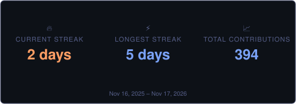
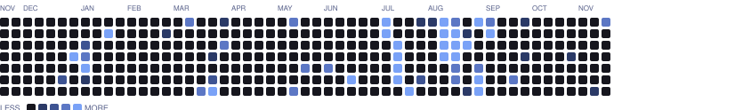

<div align="center">

<!-- HEADER -->


<!-- TYPING TAGLINE -->
<br/>


<!-- BADGES -->
<br/><br/>
<a href="https://github.com/PhaNtoM-GHosT-11101"></a>
&nbsp;

&nbsp;

&nbsp;


</div>

---

## ⚡ About Me

```typescript
const aditya = {
  handle     : "PhaNtoM-GHosT-11101",
  pronouns   : "he/him",
  location   : "Tripura, India 🇮🇳",
  studying   : "NIT Agartala",
  philosophy : "If it sounds fun, I'll build it.",
  building   : "Slate — a Qt 6 settings app for a tablet Linux ignores",
  askMeAbout : ["Linux", "Terminal UIs", "Qt / C++", "PWAs", "EPUB parsing"],
  funFact    : "I got tired of reading apps, so I built my own.",
};
```

---

## 🖊️ Currently Building — Slate

<div align="center">
  <a href="https://github.com/PhaNtoM-GHosT-11101/slate">
    
  </a>
</div>

> My drawing tablet works on Windows and macOS. On Linux it was a rectangle that drew in the wrong place — so I wrote the settings app it was missing. Screen mapping, pen pressure curves, and all twelve express keys, in one small Qt 6 app that edits your Hyprland config safely and rolls back if the reload fails.

`C++` `Qt 6` `Wayland` `Hyprland` `evdev`

[**Repository →**](https://github.com/PhaNtoM-GHosT-11101/slate) · [**v0.2.0 release →**](https://github.com/PhaNtoM-GHosT-11101/slate/releases/tag/v0.2.0)

---

## 🚀 More Projects

<div align="center">

|  |  |
|:---:|:---:|
| **📖 PageHabit** | **🎨 Adi Draw** |
| Every reading app is built to keep you scrolling. This one is built to get out of the way — exact page turns, bionic reading, offline-first, no recommendations. | A whiteboard where the pens, colors, and shortcuts are yours. Pressure-sensitive ink, layers, sticky notes, and an incremental renderer that stays fast. |
| `Vanilla JS` `PWA` `Firebase` | `TypeScript` `Canvas` `Electron` |
| [**Live →**](https://phantom-ghost-11101.github.io/pagehabit/) · [Code →](https://github.com/PhaNtoM-GHosT-11101/pagehabit) | [**Code →**](https://github.com/PhaNtoM-GHosT-11101/Adi_Draw) |

</div>

### 🎵 Phantom Player

A music player that lives in the terminal. `mpv` does the audio, Textual does the UI, and there is no Electron anywhere near it.

```bash
$ phantom-player --now-playing
┌─────────────────────────────────────────────────────┐
│  ♪  Phantom Player                                  │
│  ─────────────────────────────────────────────────  │
│  ▶  Now Playing                                     │
│  ████████████████░░░░░░░░  02:34 / 05:48            │
│                                                     │
│  [Q] Quit  [Space] Pause  [N] Next  [P] Prev        │
│  [+/-] Volume  [S] Shuffle  [L] Loop                │
└─────────────────────────────────────────────────────┘
```

`Python` `Textual` `mpv` · [**Code →**](https://github.com/PhaNtoM-GHosT-11101/phantom-player)

---

## 🛠️ Tech Arsenal

<div align="center">
  
</div>

---

## 🔥 Streak & Activity

<div align="center">
  <!-- auto-generated daily by .github/workflows/update-activity.yml -->
  
  <br/><br/>
  
</div>

---

<div align="center">
  
  <br/>
  <sub><i>"Just a guy who wants to explore everything."</i></sub>
</div>
